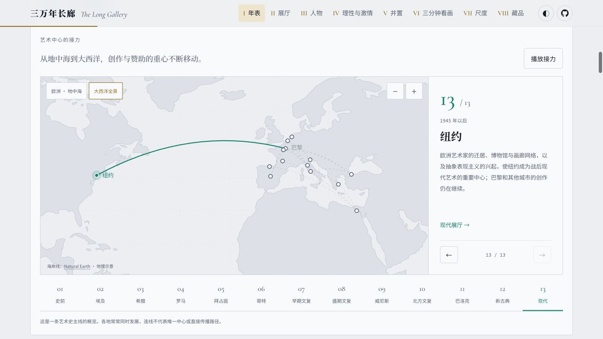

# 三万年长廊 · The Long Gallery

**一部可以走进去的艺术史。**

从拉斯科洞窟里的野牛，到纽约展厅里的小便池。在漂浮的画海中偶遇一件作品，沿年表找到它的时代，再走进展厅，看看艺术家为什么这样画。

[进入长廊](https://www.ferecord.com/art-history-atlas/) · [GitHub Pages](https://tumars.github.io/art-history-atlas/) · [设计文档](docs/design.md) · [参与贡献](CONTRIBUTING.md)


## 可以怎样逛

不必从头读到尾，可以从一幅画、一个人，或者一个问题开始。

| 想看什么 | 从哪里开始 |
| --- | --- |
| 随意发现作品 | **浮空画海**：422 件有图作品散落漂浮，拖动可首尾相接地探索；远近景随动作变化，点击作品看大图。 |
| 理清时代与背景 | **年表**：把艺术时期、代表作、历史大事与中国朝代放在一起看；沿地图追踪艺术中心的迁移。 |
| 理解一种风格 | **十八间展厅**：每间从一个核心问题出发，结合原作、展签与交互图解，观察透视、构图、光线和色彩。 |
| 认识艺术家与派系 | **人物**：按艺术派系浏览，切换生命线与关系图，查看师承、影响、对手、赞助与真实相遇。 |
| 比较作品的不同 | **理性与激情、并置**：看风格如何转向，在 7 组作品对照中寻找细节。 |
| 花几分钟认真看画 | **三分钟看画**：位于并置之后，5 篇短故事与 4 条现代艺术路线，带着问题看局部，再展开背景。 |
| 看原作有多大、细看收藏 | **尺度、藏品**：比较作品尺寸，在看片台用缩略图或方向键逐件翻看。 |

支持手机浏览、浅色 / 深色 / 跟随系统主题，以及“减少动态效果”偏好。展厅、人物和看画故事都有独立链接，方便分享与回访。

## 几个值得停留的地方

### 按派系看人物，也看他们的关系

67 位人物，29 个画派、艺术运动与历史传统。选择“印象派”，就能看到本派人物的关系；也可以展开跨派系联系，或者切回全部人物。点击头像，继续读生平、作品与相关人物。


### 跟着地图，看艺术中心的接力

从地中海到大西洋，13 站串起创作与赞助重心的变化。可以播放路线、拖动和缩放地图，也可以选择城市，读介绍后直接进入相应展厅。



### 在原作上找答案

《梅杜萨之筏》的视线怎样从低处升起？透视为什么能制造纵深？展厅中的 17 个图解用原作叠线、拖动和对照帮助观察，每个都对应具体作品。史前展厅以作品和文字介绍为主，不强设图解。

> 截图取自当前本地版本；在线版本可能随发布进度有所不同。图片保存在 [`docs/screenshots/`](docs/screenshots/) 中。

## 本地运行

使用 Node.js 18 及以上版本，推荐使用仍受维护的 LTS 版本。

```bash
npm ci
npm run dev
```

打开终端输出的本地地址，通常是 `http://localhost:5173`。

| 命令 | 用途 |
| --- | --- |
| `npm run build` | 类型检查、内容校验，并构建到 `dist/` |
| `npm run preview` | 预览构建后的静态站点 |
| `npm run check` | 类型检查与内容校验 |
| `npm test` | 检查画海布局、透视、景差与定位 |
| `npm run validate` | 仅校验内容数据、引用与图片 |
| `npm run fetch-images` | 从维基文件页及馆藏网站获取作品图片 |

## 内容与开发

项目使用 **TypeScript + Vite**，构建为静态站点。展厅文字、作品、人物与关系等内容使用 JSON 管理，内容修订通常不需要修改界面代码。

```text
content/
├── site.json                 站点信息、时间轴分段、推荐阅读
├── context/                  欧洲分期、中国朝代、教会历史等背景
└── traditions/western/       西方艺术史的时期、作品、人物、派系与看画故事
src/
├── sections/                页面分区与交互
├── diagrams/                展厅图解
└── styles/                  主题与样式
public/images/               作品图片、缩略图与署名数据
docs/                        设计、调研与页面截图
```

- 补充作品、修正年代或新增看画故事：阅读[贡献指南](CONTRIBUTING.md)。
- 了解数据结构、页面设计与交互规则：阅读[设计文档](docs/design.md)。
- 调整图解：参考[图解复查记录](docs/research/diagram-review.md)。

修改页面结构、数据格式或交互规则时，请同步更新设计文档。目前内容聚焦西方艺术史；其他艺术史体系可按 `traditions/` 的结构扩展。

## 图片与资料来源

目前收录 **423 件作品，其中 422 件配图**。图片来自[维基共享资源](https://commons.wikimedia.org/)、维基百科文件页与馆藏官网；作者、来源和权利说明逐张记录在 [CREDITS.md](CREDITS.md)，也可在页面展签和大图中查看。

古代摹本、历史复原图与局部图会注明版本。《赛跑手拉达斯》因原作失传且无已知摹本，仅保留文献说明。作品百科入口统一使用中文维基百科；无对应条目时进入中文搜索，图片来源链接仍指向实际文件页或馆藏页。

图片可在本地用 `npm run fetch-images` 获取，也可在仓库 **Actions → 从维基共享资源取图 → Run workflow** 中运行取图工作流。

## 阅读起点

这个项目最初是意公子《大话西方艺术史》的读书复盘页，后来逐步扩展成可交互的艺术史长廊。也可以结合这些书一起逛：

- 蒋勋《写给大家的西方美术史》
- 顾爷《小顾聊绘画》系列
- 威尔·贡培兹《现代艺术150年：一个未完成的故事》
- 贡布里希《艺术的故事》
- 意公子《大话西方艺术史》

七种大众艺术史读物的叙事方法、选题与来源，整理在[艺术史畅销书调研](docs/research/art-books.md)中。

## 许可

- **代码**：[MIT](LICENSE)。
- **文字内容**（`content/` 与 `docs/`）：[CC BY-SA 4.0](CONTENT_LICENSE.md)。
- **作品图片及截图中的作品**：遵循各自来源页的授权或权利说明，不属于项目的 MIT 授权，详见 [CREDITS.md](CREDITS.md)。

内容按通行艺术史知识整理，年代多为约数；图解中的示意与分析会在图旁说明。欢迎通过 Issue 或 PR 补充作品、纠正错误，或交流看画时的新发现。
