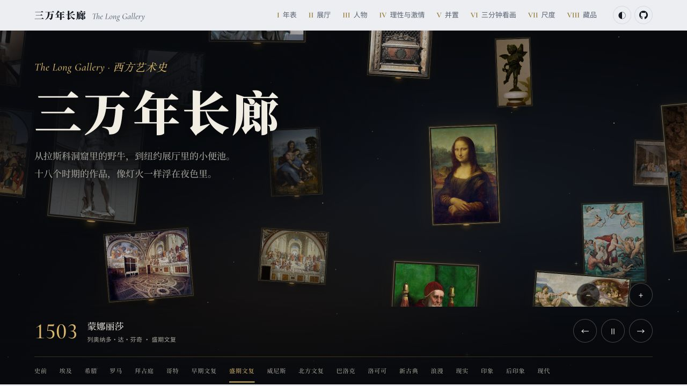
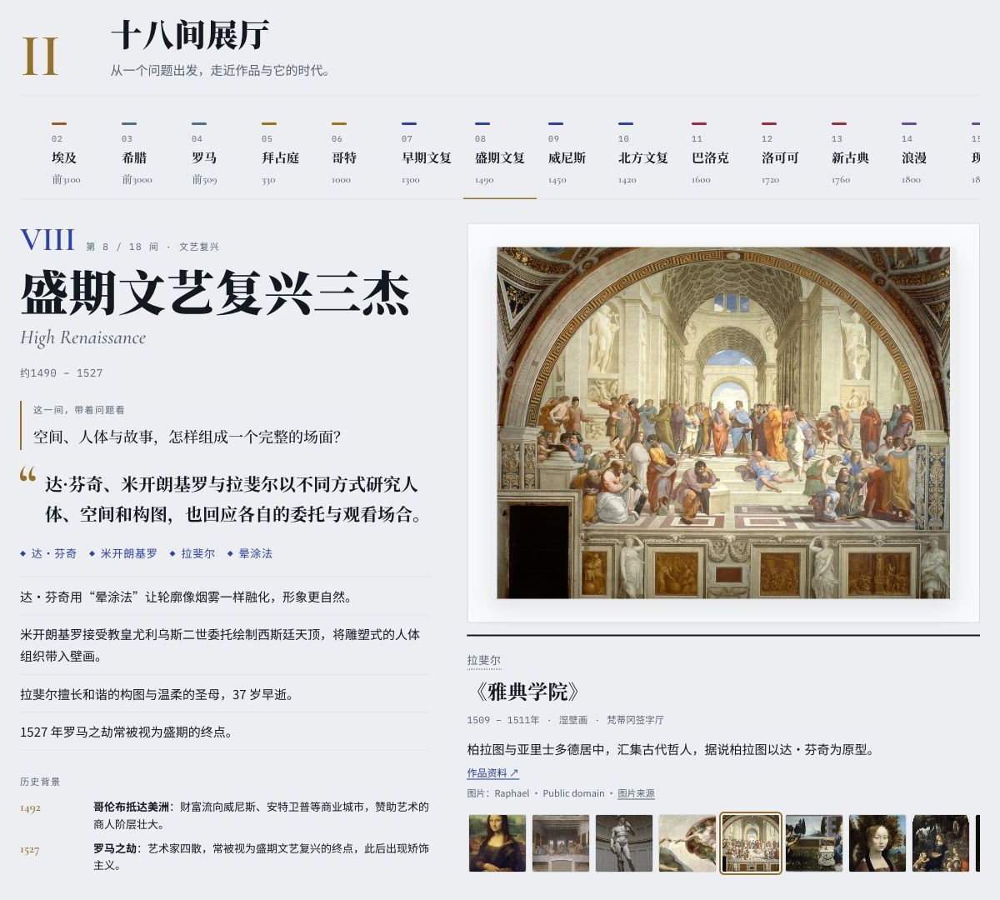
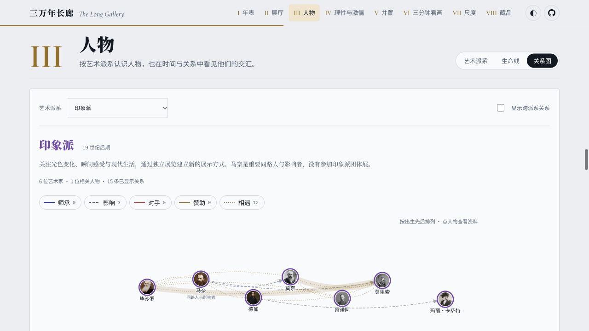

# 画间 · Huajian

**在画作之间，读懂西方艺术。**

画间是一座可以自由探索的西方艺术史在线展馆。从史前洞窟到现代艺术，你可以在画海中偶遇一件作品，走进它所属的时代，也可以沿着人物关系和看画故事，理解艺术为什么会变成今天的样子。

不必从头读到尾。从一幅画、一个人，或一个问题开始。

[进入画间](https://www.ferecord.com/art-history-atlas/) · [备用访问](https://tumars.github.io/art-history-atlas/) · [设计文档](docs/design.md) · [参与贡献](CONTRIBUTING.md)



## 从哪里开始

| 你的好奇 | 在画间可以做什么 |
| --- | --- |
| 想随意看看画 | 在 **422 件有图作品组成的画海** 中拖动漫游，拉近细看，或按艺术时期寻找作品。 |
| 想看懂一个时代 | 走进 **十八间展厅**，从一个具体问题出发，结合原作、背景和交互图解理解艺术风格。 |
| 想认识艺术家 | 探索 **67 位人物、29 个画派与历史传统**，沿师承、影响、对手、赞助和相遇理解他们的联系。 |
| 想把艺术放回历史里 | 对照艺术年表与历史事件，沿地图追踪创作和赞助中心的迁移。 |
| 想花几分钟认真看画 | 跟随 **5 篇看画故事、4 条现代艺术路线**，从局部观察走向作品背后的问题。 |
| 想比较与发现细节 | 并置作品、比较原作尺寸，借助 **17 个交互图解** 观察透视、构图、光线与色彩。 |

## 在作品、人物与时代之间穿行

### 从原作出发，看懂风格

每间展厅都从问题开始。例如，盛期文艺复兴关注“空间、人体与故事，怎样组成一个完整的场面？”看过达·芬奇、米开朗基罗和拉斐尔的作品，再用图解理解画面里的选择。



### 看见艺术家之间的联系

按派系浏览人物，也可以展开跨派系关系。关系图区分师承、影响、对手、赞助和相遇；点选人物，继续阅读生平与作品。连线来自已收录的关系资料，不把同时代自动视为相互影响。



### 手机也能随时逛

移动端以 **画海 / 导览 / 探索 / 收藏** 四个入口组织内容：先看作品，再走进展厅、故事和艺术脉络。喜欢的作品可以留在本机收藏，阅读进度与页面位置支持恢复。

桌面适合展开年表、作品和关系图；手机适合随手发现、逐件细看。两端支持浅色、深色和跟随系统主题，并尊重减少动态效果的系统偏好。展厅、人物与故事支持独立链接。

> 截图展示部分界面；仓库与在线体验可能随版本更新有所差异。

## 本地运行

需要 Node.js 20.9 或以上版本，推荐使用仍受维护的 LTS 版本。

```bash
npm ci
npm run dev
```

访问终端输出的本地地址。

| 命令 | 用途 |
| --- | --- |
| `npm run build` | 生成浏览用图片、检查类型与内容，构建到 `dist/` |
| `npm run preview` | 预览构建后的站点 |
| `npm run check` | 类型检查与内容校验 |
| `npm test` | 画海、搜索、导航与图片加载的单元测试 |
| `npm run fetch-images` | 获取作品图片并生成浏览用 WebP |
| `npm run optimize-images` | 从本地原图生成缩略图和展示图 |

## 内容与开发

使用 **TypeScript、Vite 与 Motion**，构建为静态站点。作品、时期、人物、派系和故事以 JSON 管理，内容修订通常不需要修改界面代码。

```text
content/                 站点信息、艺术史内容与历史背景
src/mobile/              手机页面、画海与触控交互
src/sections/            桌面分区与共用交互
src/diagrams/            展厅图解
public/images/           作品图片、缩略图与署名数据
docs/                    设计、调研、验证记录与截图
```

- 补充作品、修正年代或改善交互：阅读[贡献指南](CONTRIBUTING.md)。
- 了解页面组织、数据结构与设计取舍：阅读[设计文档](docs/design.md)。
- 修改图解前，参考[图解复查记录](docs/research/diagram-review.md)。

**设计文档也是项目的一部分。** 修改页面结构、数据格式或交互规则时，请同步更新相关设计说明。

## 资料与来源

目前收录 **423 件作品，其中 422 件配图**。图片来自维基共享资源、维基百科文件页与馆藏官网，作者、来源和权利说明逐张记录在 [CREDITS.md](CREDITS.md)，也可在页面展签和大图中查看。古代摹本、历史复原与局部图会注明版本；没有可靠配图的作品保留文献说明。

画间始于意公子《大话西方艺术史》的读书复盘，逐渐扩展成可交互的艺术史展馆。也推荐结合贡布里希《艺术的故事》、蒋勋《写给大家的西方美术史》、顾爷《小顾聊绘画》和威尔·贡培兹《现代艺术150年》阅读。更多选题与叙事参考见[艺术史读物调研](docs/research/art-books.md)。

欢迎通过 Issue 或 PR 补充作品、纠正错误，或分享看画时的新发现。

## 许可

- **代码**：[MIT](LICENSE)。
- **文字内容**（`content/` 与 `docs/`）：[CC BY-SA 4.0](CONTENT_LICENSE.md)。
- **作品图片及截图中的作品**：遵循各自来源页的授权或权利说明，不属于项目的 MIT 授权，详见 [CREDITS.md](CREDITS.md)。
