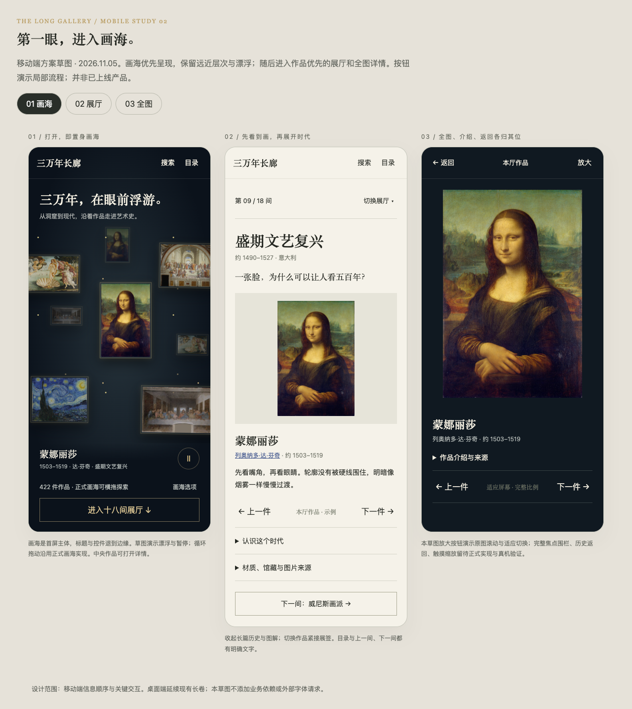

# 移动端调研与重设计方案

日期：2026-11-05。状态：方案已细化并落实到本地实现，未发布；真机验收待补。下文保留调研与设计推导，实际行为以主设计文档第 2.1 节及文末实施说明为准。

## 1. 结论与范围

手机首先呈现可探索的浮空画海，再连接可以随时进入、看完一件再继续的长廊。根据 2026-11-05 用户反馈，画海效果是首屏优先级，不收进二级入口，也不替换为单幅封面。优先解决看不到完整作品、导航难理解、背景先于作品、跨区跳转难返回四个问题。保留夜色序厅、纸色展墙、衬线标题、作品完整比例与来源说明。

这次不引入账户、收藏同步、推荐算法、新内容体系或前端框架。继续共用现有 JSON、作品详情、人物资料与故事。先修基础布局，再重排手机阅读路径；桌面保留现有长卷。

## 2. 调研方法与证据

检查了 `index.html`、`src/styles/`、展厅、年表、人物、搜索、故事、大图实现及主设计文档。在本地 Vite 上使用 Chrome 无头模式，以 390 × 844、触摸和移动视口模拟检查当前页面。另查阅既有阅读验证记录，但不将此前“无横向溢出”当作当前结论。

这是一轮代码审查与模拟浏览器启发式评估，没有真实用户访谈、线上行为统计或 iPhone / Android 真机测试；不据此声称转化率、性能或学习效果提升。下文的优先级来自任务受阻程度，不是用户频次统计。

| 发现 | 当前证据 | 影响与优先级 |
|---|---|---|
| 页面发生横向溢出 | 模拟浏览器中根元素 clientWidth 为 390，scrollWidth 与 innerWidth 为 791；展厅作品按钮测得 569px 宽 | P0：影响页面与固定弹层可用尺寸，先定位 grid 内在尺寸及图片约束，不能用全局隐藏横向溢出掩盖 |
| 顶栏难以辨认 | 900px 以下隐藏分区中文名；390px 下索引只有 113px 可用宽度，初始只露出 I–IV | P0：后半分区不可发现，罗马数字不能说明目的地 |
| 作品详情裁切 | 当前模拟截图中雕像占满并溢出视野；手机布局为图像 + 最高 42vh 的独立滚动说明 | P0：先修全图适配，动作不能藏在说明末尾；裁切具体成因须在隔离溢出后复测 |
| 首屏入口不明确 | 手机 hero 最小 740px；390 × 844 时约 785px，另有顶栏；缩放、漂浮、时期和翻画控件同时出现 | P1：大部分首屏用于探索操作，缺少明确“开始逛展厅” |
| 展厅先读长文再看画 | 单栏时 intro 整块在 feature 前；本次初始展厅 intro 约 977px 高 | P1：进展厅后至少一屏文字，核心作品延后 |
| 图表仍以桌面宽度工作 | 年表 min-width 860px，生命线和关系图 900px，钟摆 820px；年表作品单元仅 26 SVG 单位 | P1：读者同时管理页面纵滚、图内横滚和小目标点击；SVG 通用 pan-y 规则还需实测横滑是否受限 |
| 作品切换远离作品 | 展厅缩略图在完整说明与署名之后；藏品手机隐藏全部时期文字，保留细段 | P1：难以知道当前在哪个时期、如何换下一件 |
| 返回语义不完整 | 展厅、人物、故事主要使用 replaceState；大图未建立返回历史，也未见焦点围栏 | P1：浏览器返回不能按进入顺序恢复；键盘焦点可能进入背景 |
| 局部控件偏小 | 顶栏图标 34px，大图关闭 40px，故事观察点 32px；手机派系次级文字低至 9px | P1：单手操作和阅读困难 |

复核入口：`src/styles/main.css` 的 `.index`、`.hero`、`.hall`、`.lightbox`、`svg.dg`，以及 `src/sections/{hall,lightbox,people,readings}.ts`。不要把超宽 SVG 本身等同于整页溢出：图内滚动可以合法存在，要检查其祖先是否正确约束。

## 3. 信息架构：一条主线，两种旁路

主线：序厅 → 十八间展厅 → 本厅作品 → 下一间。

短时访问：序厅 → 三分钟看画 → 相关作品 / 展厅。

目标访问：搜索作品或人物 → 详情 → 返回原搜索结果。

手机顶栏只保留站名、搜索、目录。目录是原生模态面板，按“开始观看”（展厅、三分钟看画、藏品）和“理解脉络”（年表、人物、理性与激情、并置、尺度）列出中文名称；当前项有文字标记。主题切换、源码与回到序厅放在目录底部。所有原有分区都可到达。

首版保留单页与现有分区锚点，不构建四套独立 tab 页面，也不同时保留顶部分区横条、固定底栏、页内吸顶条三套导航。手机正文顺序建议：序厅 → 展厅 → 三分钟看画 → 年表 → 人物 → 理性与激情 → 并置 → 尺度 → 藏品。桌面维持当前顺序。顺序变化必须同步 DOM 与键盘阅读顺序，不能只用 CSS order 形成视觉与朗读差异。

## 4. 核心页面与交互

### 序厅：画海优先，入口清晰

- 打开页面直接进入浮空画海：多幅作品按远、中、近层错落呈现，保留星尘、缓慢漂浮和拖动景差。画海是主要交互，不是装饰背景；首屏可探索区域以可用高度的约六成为布局目标。
- 站名与一句导语压缩在上方，不用大标题占据半屏；底部保留紧凑的当前作品展签和“进入展厅”入口。390 × 844 与 375 × 667 下入口均应可见，短屏优先压缩文案与空白，不把画海压成横幅。
- 直接复用现有循环画海与 422 件有图作品，附近预览按需加载，不要求再点“探索画海”。横拖探索、纵滑进入正文、点作品看大图；拖动与点击分离，保留浏览器双指缩放。
- 暂停按钮始终可达；时期、远近与逐件切换收进“画海选项”，减少同屏控件。主画面不自动换图或大幅飞移，保留轻微漂浮；减少动态效果时静止呈现层次，仍可直接拖动。
- “三分钟看画”放在目录与序厅之后的快捷入口，不和画海争夺首屏面积。
- 有历史展厅时提供“继续：××展厅”，与“从第一间开始”分开，避免按钮文字与恢复行为不一致。

### 展厅：先看画，再理解时代

顺序固定为：当前厅与选择器 → 时期名、年代、开场问题 → 主作品 → 标题作者与看点 → 作品切换 → 背景 / 图解 → 下一间。

- 顶部“第 09 / 18 间 · 盛期文艺复兴 ▾”打开按大阶段分组的完整目录，保留上一间 / 下一间。切厅后标题进入视口并获得程序焦点；不留在上一厅的页面底部。
- 主作品采用完整比例，墙面留白，不裁切；图片高度随短屏调整，不要求所有作品强行同高。点击打开全图。
- 展签第一层只放标题、可点作者、年代、两三行看点和来源入口。完整材质、馆藏、研究与权利说明仍可展开阅读，来源不能删除。
- 作品切换紧跟图片与简短展签：有文字的前后按钮、`3 / 12` 计数、至少 56px 缩略图。横滑仅为增强，所有操作都有点击替代；切作品保持图框位置。
- 历史背景和要点合并为“认识这个时代”；图解独立为“动手看懂：具体标题”，用户主动展开。开场问题始终可见。展开状态保留到本厅离开，切到新厅默认收起。
- 本厅末尾用现有过渡语与明确下一厅名承接。短屏不叠加永久固定的展厅工具栏。

### 作品详情：一层全屏、明确返回

- 用原生 dialog 或等价的完整模态实现。顶部始终可见“返回”和计数；先解决全图 contain 与高度约束，默认不是原尺寸。
- 下方可见标题、作者与“作品介绍”展开按钮；展开后采用同一个内容滚动区，避免画面、说明、整页三层纵向滚动。底部上一件 / 下一件不随长说明消失。
- 提供显式“放大 / 适应屏幕”按钮；缩放模式内拖动只平移图片，不切作品；退出缩放恢复全图。初版保留浏览器双指缩放，不承诺未经真机验证的自定义捏合手势。
- 点背景不再意外关闭；用返回按钮、系统返回或 Esc 退出。焦点留在模态内，退出回原入口，保留原页面滚动位置。
- 从搜索进入时保留关键词、筛选与结果滚动位置；关闭作品回到搜索结果。从详情跳人物时关闭作品并进入人物资料，返回能回到原作品。

### 人物与图表：先给可读内容，再给全貌

- 人物默认保留已有“艺术派系”，姓名至少 15px，次级文字至少 12px；用单列或真正容得下的两列。选择人物后紧邻呈现资料，避免跳到长页面不明位置。
- 人物“关系”先用现有师承、影响、对手、赞助、相遇数据生成可点关系清单；关系图与生命线作为“查看全貌”的显式入口，保留当前派系范围。
- 年表手机默认按艺术时期纵向展示：时期、代表作、关键事件；中国朝代 / 欧洲历史 / 教会史按需展开。对应关系复用既有区间与明确关联，不根据年代凭空推断影响。
- 完整年表与关系图在独立查看层中使用局部横滚，带当前时期、复位和文字选择器。纵滑页面与横拖图分工明确，不能只提示用户横屏。
- 地图保留，但先展示当前站的城市、作品或时代关联与前后站按钮；地图可展开。选纽约等预设仍沿用现有逻辑。
- 理性与激情提供逐时期文字解释入口，完整钟摆作为补充；尺度保留真实相对比例，不为塞满手机而分别放大两件作品。

### 三分钟看画、并置、藏品、搜索

- 故事显示“第 1 / 3 步”与当前问题，作品先于长文；观察标记热区 44px，图太小时同步提供文字按钮。下一步后回到该步标题，返回上一步保留答案与展开状态。
- 比较默认两个完整小图同屏，便于观察关系；每幅可单独放大，也可切换纵向大图。对照任务不能变成两幅作品相隔数屏。
- 藏品保留看片台，增加可读的时期选择器；隐藏文字的比例细条仅作分布信息，不承担主要导航。缩略图只预加载附近范围。
- 搜索为手机全屏模态，输入字号至少 16px；软键盘出现时结果区适应可见视口，关闭和清空可达。无结果给出修改关键词的明确反馈。

## 5. 通用视觉、手势与状态规则

| 项目 | 设计约束 |
|---|---|
| 响应范围 | 建议 ≤700px 启用手机内容组织，701–1024px 使用窄屏布局，宽屏保持现有；具体断点以内容能否容纳验证 |
| 间距 | 页面左右 20px；320px 可收至 16px；以细线和留白组织，避免每段都套卡片 |
| 字体 | 正文 16px / 1.75，次级信息 13px，来源最低 12px；沿用现有中西文衬线与系统回退 |
| 操作目标 | 常用按钮至少 44 × 44 CSS px，图上密集目标提供列表替代；相邻操作留出间隙 |
| 图片 | 完整比例优先，容器 min-width:0，显式约束宽高；占位保留比例，加载失败保留标题与来源 |
| 滚动 | 根页面不得横向溢出；横向交互限定在明确容器内；一处只保留一个主要纵向滚动区 |
| 安全区 | 顶底操作计入 safe-area；动态工具栏、横屏与软键盘状态不遮挡关闭按钮 |
| 动效 | 首屏不自动飞移；遵守 reduced-motion；离屏停止动画，展开不造成图片跳位 |
| 历史 | 用户进入详情 / 人物 / 故事使用可返回的历史项；同一查看器内切图替换该项；关闭等价返回一层；直接深链没有站内前项时返回所属分区，不意外退出网站 |
| 可访问性 | 模态焦点管理、关闭后焦点恢复、中文按钮名、当前状态不只靠颜色；200% 文字缩放后可操作 |

历史状态只需记录当前类型、ID、来源及来源滚动位置，继续由现有 actions 连接模块；不为此引入完整路由框架。切换屏幕宽度不重置正在看的作品或故事。

## 6. 实施顺序与代码落点

1. **先恢复基本可用性（P0）**：定位全页溢出，修正 grid 与图片尺寸；修全图弹层、关闭和焦点；把手机数字导航换为中文目录。主要涉及 `main.css`、`index.html`、`main.ts`、`lightbox.ts`。
2. **建立看画主线（P1）**：保持画海为首屏主体，压缩标题并收纳次级控件；拆分展厅简介的标题 / 背景，先图后文；把切图放到作品旁；详情返回、搜索恢复。涉及 `hall.ts`、`hero.ts`、`search.ts` 与 shared actions。更新设计文档中的已实现规范。
3. **改善深度探索（P1）**：年表纵向摘要、人物关系清单与图表查看层；改造故事、藏品、比较与尺度。复用现有数据，先做到所有内容可读可达，再逐项优化图表手势。

分阶段交付，每阶段独立检查。不要以“手机重设计”为由重写桌面所有模块。新的目录和图表查看层可共用少量模态基础能力，但不抽象成通用页面引擎。

## 7. 验收与用户试读

实现后覆盖 320、375、390、430px 宽度，以及 667px 短屏、横屏、平板和桌面。至少一次 iOS Safari 与 Android Chrome 真机验证；Chrome 模拟不能替代双指缩放、地址栏变化、系统返回和软键盘。

- 所有主要状态的根 scrollWidth 不超过 clientWidth（容许 1px 舍入）；不能仅用 overflow-x:hidden 通过检查。
- 初次进入无需操作即看到多幅、有远近层次的浮空画海，可横拖探索且纵滑不被阻断；暂停与进入展厅均可达。进展厅首屏能见作品主体；全图模式未缩放时作品四边均可见。
- 任意展厅能从目录两次点击内进入；选择下一间后标题与作品可见。
- 搜索“梵高” → 作品 → 人物 → 返回，逐层恢复原上下文；直接打开现有 `#p-*`、`#who-*`、`#story-*` 仍正确。
- 使用触摸、鼠标、键盘均能完成切厅、切图、看故事与关闭详情；模态开启时 Tab 不进入背景。
- 断网图片失败、慢网、减少动态、浅深色与 200% 文字缩放不阻断阅读；图片仍按预览 / 展示 / 大图分级加载，不预载全部原图。
- 正式验证执行现有 `npm run check`、`npm test`、`npm run build`，另对历史返回与模态焦点补必要的行为测试；文档提案本身不声称这些检查已跑。

建议请 3–5 位非开发者各做四个任务：进入文艺复兴看一幅画、找梵高并返回搜索、完成一篇三分钟故事、说出两位人物的关系。记录是否独立完成、误触和迷路位置；这是下一轮验证计划，不是本次已完成的调研。

## 8. 可视方案

[三屏可交互版式草图](../prototypes/mobile-redesign.html)：展示入口、展厅、作品详情；支持选择屏幕、展开背景、打开详情和返回。使用真实本地作品图，内容为示意，不连接完整数据与历史栈，不能作为手势与性能验收依据。

第一版草图检查过切屏、放大、返回与展开；按用户反馈将单幅封面替换为画海。草图只演示少量图片的层次与漂浮，不模拟正式画海的循环拖动和全量作品；当前实现复用现有完整画海。草图含额外的设计说明页头，不能用它判断正式产品首屏高度目标是否达成。

## 9. 细化与实施结果

- 采用 700px 作为手机组织断点；直接移动既有节点，使视觉、键盘与朗读顺序一致。横竖屏跨过断点时恢复对应布局。
- 画海不新建查看层。暂停在首屏，其余原有控件移动到原生选项对话框；所有原有作品、循环空间与图片延迟加载保留。
- 展厅拆分标题 / 开场问题与时代背景，不只交换两列；现代艺术主题路线放在主作品之后。桌面背景保持展开，手机按需展开。
- 完整图表使用同一个查看层容器，移入原图而非复制 SVG。返回后恢复节点位置；人物筛选与年表比例切换仍可操作。人物关系摘要复用明确的关系字段，其余关联仍在资料卡中完整可读。
- 大图使用原生 dialog；在原生模态之外补显式 Tab 首尾循环，避免键盘焦点越过查看器。搜索、作品、人物和故事使用站内历史快照恢复来源。新增两项行为测试覆盖嵌套进入、前后退、深链关闭与历史分支。
- 根溢出的具体来源包括并置区 grid 子项和图片固有尺寸。通过收缩约束与自动尺寸修复，未给根元素添加横向裁切。
- 原方案“继续上次 / 从第一间开始”未额外增加两个首屏按钮：沿用既有展厅位置记忆，入口统一称“进入十八间展厅”，完整目录可直接选第一间，避免与画海争面积。
- 不实现自定义捏合缩放、账户、持久化阅读进度或推荐功能。真实用户试读、真机软键盘与系统手势仍属于后续验收，不影响本轮本地实现交付。

详见[当前交互规范](../design.md#21-手机交互规范700px)与[验证记录](../verification/mobile-experience.md)。
